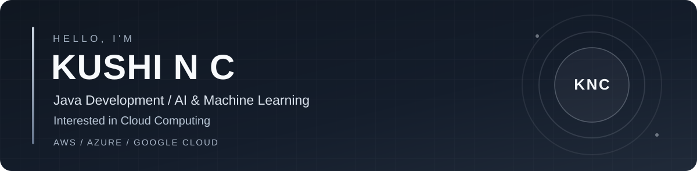

<!-- Profile repository: https://github.com/Kushi-14/Kushi-14 -->
<!-- Minimalist design. All local assets are in the assets/ directory. -->

&nbsp;

&nbsp;

**Computer Science & Business Systems** &nbsp;·&nbsp; **Jain University** &nbsp;·&nbsp; **Bengaluru, India**

## About Me

I'm **Kushi N C**, a B.Tech student in **Computer Science and Business Systems** at **Jain University, Bengaluru (2023–2027)**, with a strong interest in building useful, reliable, and impactful technology.

My core strength is **Java**, and I'm expanding my work in **Artificial Intelligence, Machine Learning, and Cloud Computing**. I enjoy taking ideas from research and design through implementation, testing, and continuous improvement.

I've worked on an **AI-powered early dyslexia risk-assessment system** and an **ML + LLM music recommendation system**. I'm also exploring cloud technologies across **AWS, Microsoft Azure, and Google Cloud Platform (GCP)**, alongside practical software development and data-driven solutions.

- **Currently working on:** A wearable human-safety device; the patent process is underway.
- **Primary interests:** Java development, AI/ML, cloud computing, recommendation systems, and problem-solving.
- **Working approach:** Research → Build → Test → Evaluate → Improve.

## Technical Toolkit

| Area | Technologies & Tools |
| :--- | :--- |
| **Programming & Web** | Java, Python, JavaScript, HTML, CSS |
| **AI & Machine Learning** | scikit-learn, OpenCV, NumPy, pandas, LLM APIs |
| **Backend & Data** | Flask, SQL, MySQL, Spotify APIs |
| **Cloud Computing** | AWS, Microsoft Azure, Google Cloud Platform (GCP) |
| **Developer Tools** | GitHub, VS Code, Canva |

*My cloud interest spans all three platforms; I am continuing to deepen my practical experience.*

## Featured Projects

| Project | What I Built | Technology |
| :--- | :--- | :--- |
| **AI-Powered Dyslexia Risk Assessment for Children** | A bilingual (English/Hindi) early risk-assessment application combining eye-tracking, handwriting evaluation, and cognitive activities. The ensemble approach showed approximately **15–20% higher predictive accuracy** than individual models in the project's evaluation, while its pipeline reduced manual analysis effort by **40%+**. | Python, OpenCV, Flask, NumPy, ML |
| **Music Recommendation System — ML + LLM** | A hybrid recommender using collaborative filtering, listening-pattern analysis, and natural-language music discovery. Project evaluation reported **~20–25% improved recommendation relevance** and **~30% less search effort**. | Python, scikit-learn, pandas, NumPy, Spotify APIs, LLM API |

Performance figures are project results reported in my resume. The dyslexia application supports early risk assessment; it is not a clinical diagnostic tool.

### In Development

**Wearable Human-Safety Device** — Exploring a practical wearable technology solution focused on personal safety. **Patent process underway**; further details will be shared when appropriate.

## Public GitHub Repositories

| Repository | Focus |
| :--- | :--- |
| [Java Internship Projects](https://github.com/Kushi-14/java-internship-projects) | Java programming exercises, including an emoji mood responder and creative job-title generator |
| [Daily Goal Reminder](https://github.com/Kushi-14/daily-goal-reminder) | Java-based reminder project |
| [Habit Strength Calculator](https://github.com/Kushi-14/habit-strength-calculator) | Java-based calculator and logical problem-solving |

*The larger AI/ML projects are described above; public source links can be added when the code is available.*

## Areas of Focus

- **Software engineering:** Java, application logic, debugging, testing, and practical development.
- **Intelligent applications:** Model evaluation, computer vision, recommendation systems, and natural-language interfaces.
- **Data & analytics:** SQL, MySQL, data preparation, and insights from user behavior.
- **Cloud computing:** Learning and using **AWS, Azure, and GCP** for modern cloud-based solutions.

## Leadership & Activities

- **Social Media & Marketing Lead — Echo Club, Jain University:** Helped increase engagement by **30–40%**, grow followers by **500+**, and raise event participation by **25%+**.
- **Event Hosting & Anchoring:** Hosted events with audiences of **100–300+** participants.
- **Hackathon:** Participated in **Vibeathon 2025**, a **36-hour offline hackathon**.
- **Volunteering:** Supported a **Women Cell international conference** with **200+ attendees**.

## Education

**Jain University, Bengaluru**  
B.Tech — Computer Science and Business Systems  
**2023–2027** · **CGPA: 8.56**

## GitHub Insights

Insights update through a third-party GitHub statistics service and may occasionally be unavailable.

---

### Let's Build Something Meaningful

[**LinkedIn**](https://www.linkedin.com/in/kushi-n-c/) &nbsp;·&nbsp; [**Email**](mailto:kushi14nc@gmail.com) &nbsp;·&nbsp; [**Resume**](assets/Kushi_NC_Resume.pdf)

*Curiosity. Engineering. Cloud. Impact.*

